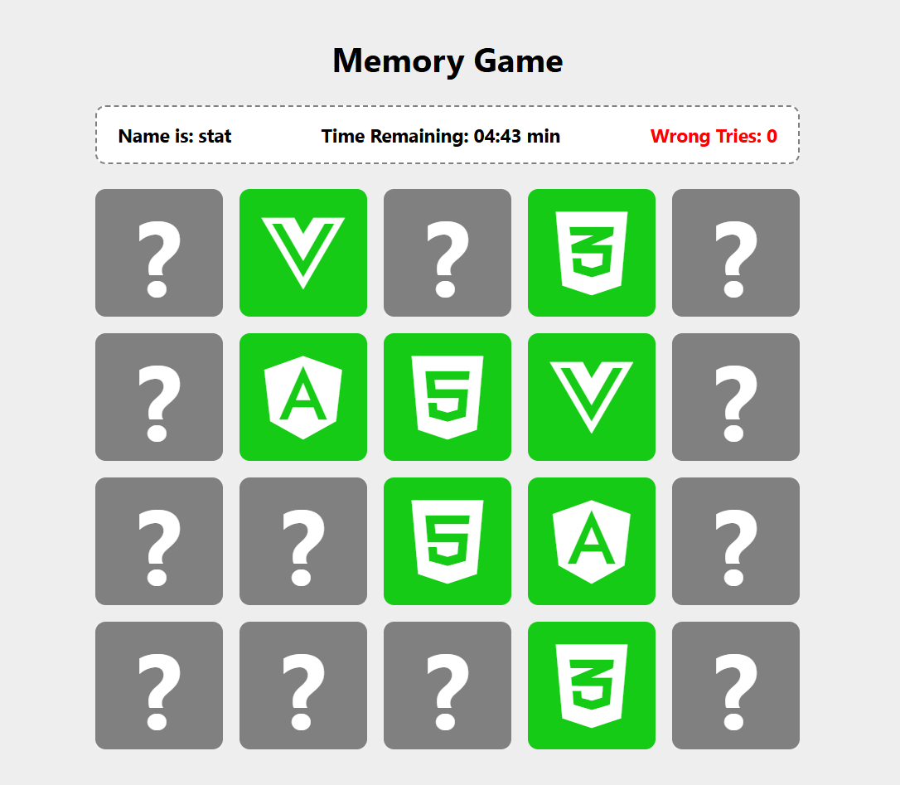

# Assign10 박은별 22300308

1. Project Information: 같은 아이콘을 가진 블럭을 맞추는 기억력 게임. 타이머와 시도횟수를 표시하고 있다./ AI가 추천해준 것 중에 가장 흥미로워 보였다./ https://github.com/khalilelemam/react-memory-game MIT License

2. Installation: git clone > npm install > npm run dev > 브라우저에서 http://localhost:5173 방문


3. Source Code Exploration:
- Project Structure: index.html-html페이지를 표시하도록 하고, 실질적으로 컨텐츠가 포함된 파일을 링크로 포함/ App.jsx-프로젝트의 자바스크립트 기본기능을 포함/ App.css-프로젝트에 필요한 실질적 css를 포함
- React Component: Block-플레이에 핵심기능을 하는 카드, 뒤집으면 해당 카드의 그림을 보여줌 / Header-유저명, 타이머, 시도횟수를 표시하는 부분
- Code Analysis: ./src/components/Winning.jsx 의 Winning 함수 - duration(4초) 만큼의 시간이 지나면 setRecycle(false) 가 실행되도록 setTimeout을 활용. duration이 끝나면 timer를 초기화 시키고, 이 과정을 duration의 값이 입력 될 때(winning 시)마다 실행되도록 함 (useEffect 함수)

4. Customizing: 수정한 3가지 내용, 수정 파일명 및 전/후 결과
- ./src/components/Result.jsx:8 - 게임결과를 알려주는 텍스트를 한국어로 변경
- ./src/index.css:14 - 맞는 그림의 블럭을 뒤집었을 때, 버튼 등에 표시 되는 초록색(rgb(21, 203, 21))을 덜 쨍한 색(rgb(159, 199, 106))으로 변경
- ./src/App.css:60-64 - 클릭 했을 때 블럭이 뒤집어지는 속도를 0.5s 에서 0.3s로 더 빠르게 수정

5. Deployment: 실제 접근 가능한 Vercel URL

6. Weekly Review:
새롭게 배운 내용 3가지
어려웠던 점과 해결 방법
AI 활용 내용 및 느낀 점 프로젝트 선정, md 파일 에 사진 첨부하는 방법


##

# Memory Game

A fun and engaging memory game built with React. Test your memory skills by matching pairs of blocks with the same icons. The game includes a timer and keeps track of your attempts.

Start Playing:  [here](https://reactjs-vite-memorygame.netlify.app/)

## Table of Contents

- [Features](#features)
- [Installation](#installation)
- [Usage](#usage)
- [Gameplay](#gameplay)
- [Contributing](#contributing)
- [License](#license)
- [Acknowledgements](#acknowledgements)

## Features

- **Interactive Gameplay**: Flip blocks to find matching pairs.

- **Timer**: A countdown timer adds a challenge to the game.

- **Audio Feedback**: Enjoy sound effects for correct and wrong matches.

- **Wrong Tries**: show number of wrong tries.

- **Winning Screen**: Celebrate your victory with a winning screen and confetti.

- **Responsive Design**: Play the game on any device.

## Installation

1. **Clone the Repository**:

   ```bash
   git clone https://github.com/Khalil-Elemam/react-memory-game.git
   cd react-memory-game
   ```

2. **Install Dependencies**:

   ```bash
   npm install
   ```

3. **Run the App:**:

   ```bash
   npm run dev
   ```

4. Open your browser and visit `http://localhost:5173` to play the game.

## Usage

1. **Start the Game**:

   - The game board will display all blocks with their icons for 3 seconds.
   - After 3 seconds, the blocks will flip back to their hidden state.

2. **Flip Blocks**:

   - Click on a block to reveal its icon. Try to find the matching pair.

3. **Match Blocks**:

   - If the icons match, the blocks will remain visible. If not, they will flip back after a short delay.

4. **Win the Game**:
   - Match all pairs before the timer runs out to win the game. A winning screen will appear, celebrating your success.

## Gameplay

- **Initial State**: All blocks are revealed for 3 seconds at the start of the game, then they flip back to their hidden state.

- **Flipping Blocks**: Click to flip blocks and reveal their icons.

- **Matching Logic**: If two flipped blocks have the same icon, they remain visible. If not, they flip back.

- **Timer**: The game includes a timer. Complete the game before the timer runs out.

- **End of Game**: The game ends when all pairs are matched or the timer finishes.

## Technologies Used

- React.js
- HTML
- CSS
- VITE

## Contributing

Contributions are welcome! If you'd like to contribute to this project, please follow these steps:

1. Fork the repository
2. Create your feature branch (`git checkout -b feature/YourFeature`)
3. Commit your changes (`git commit -am 'Add some feature'`)
4. Push to the branch (`git push origin feature/YourFeature`)
5. Create a new Pull Request

## Acknowledgements

- Special thanks to the contributors of this project.

- Audio assets from [Freesound](https://freesound.org/), which provided the sound effects for correct and wrong matches.

- Confetti effect by [react-confetti](https://github.com/alampros/react-confetti), used for the winning screen celebration.

- Icons from [FontAwesome](https://fontawesome.com/) for the game blocks.

- Inspiration and guidance from the React community and various online tutorials.

## Credits

This project was created by [Khalil Elemam].

## License

This project is licensed under the MIT License - see the [LICENSE](LICENSE) file for details.
